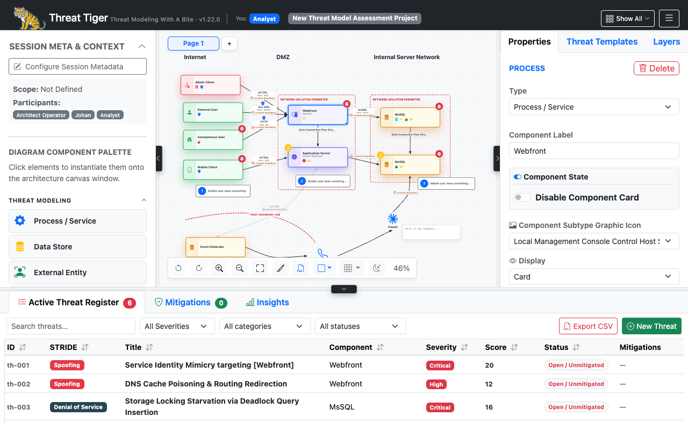
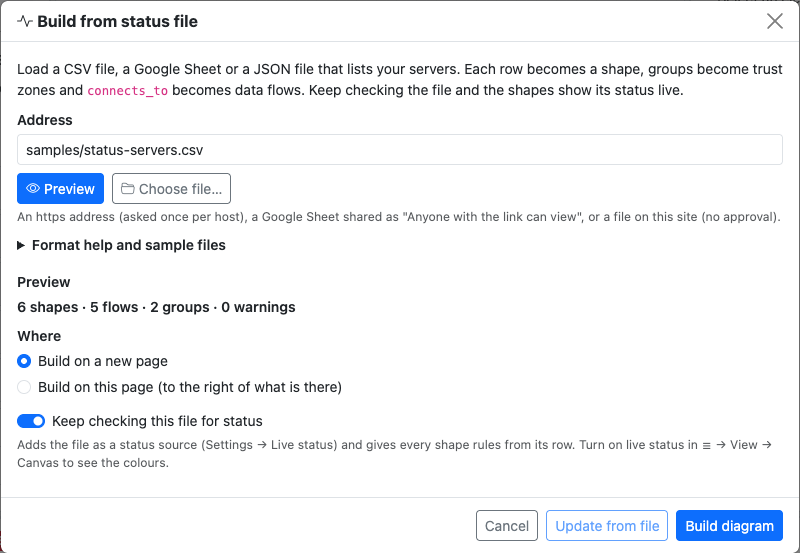
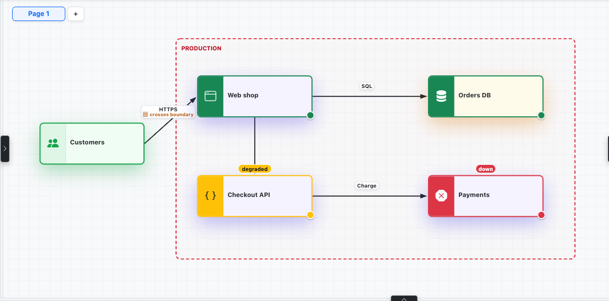
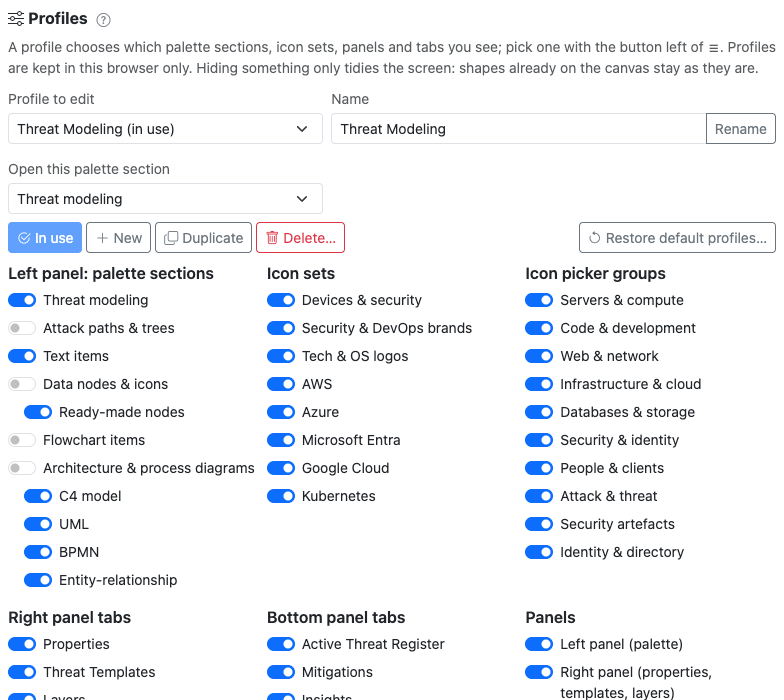
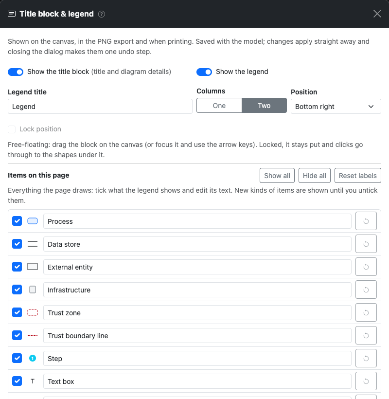
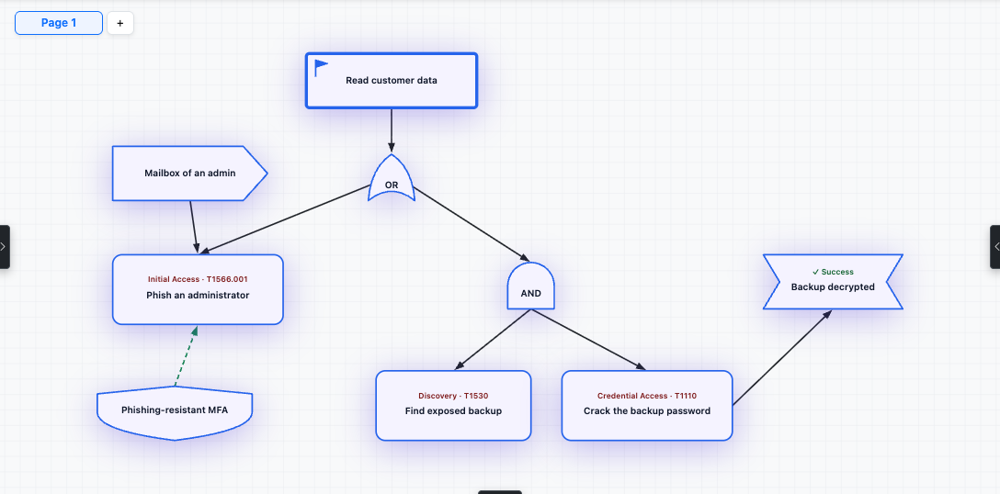
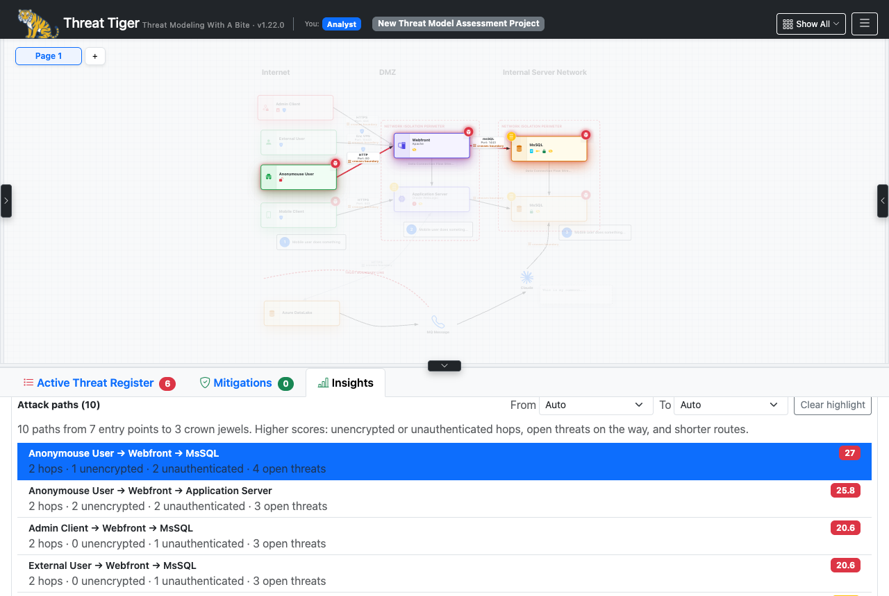
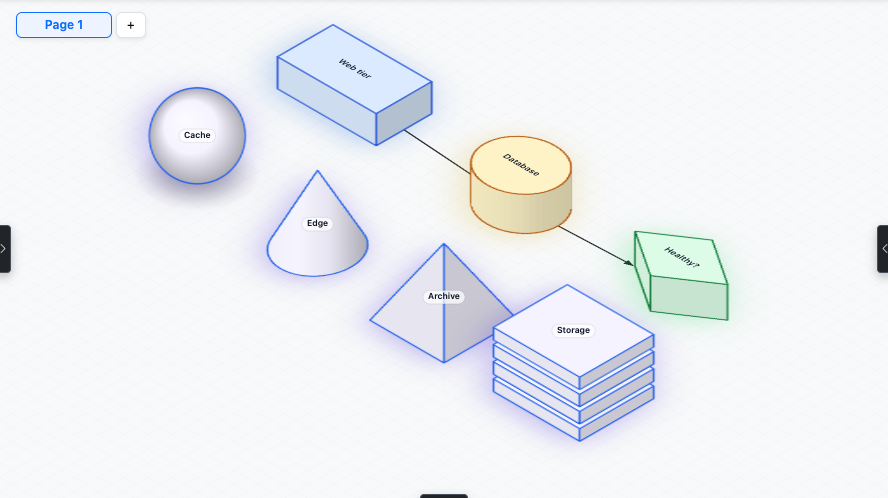
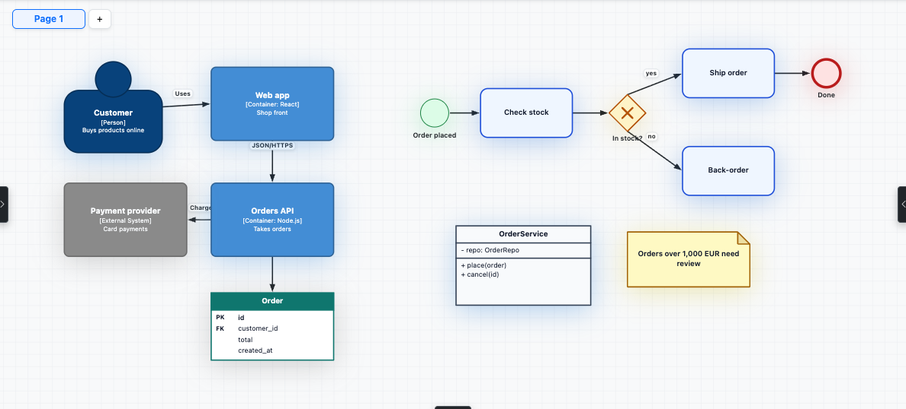

# Threat Tiger 🐯 — Threat Modeling With A Bite

**Threat Tiger** is an interactive, offline-first, client-side threat modeling web application designed to help developers, software architects, and security engineers design, analyze, and secure their system architectures.

Threat Tiger is a single HTML file plus a few local assets. It needs no installation, no database and no internet connection, and it never sends your data anywhere: your architecture and threat assessments stay in your browser and in the files you export.

**Current version: 1.23.0** (also shown in the app under Help & License). See [What's new](#whats-new-) and the [changelog](CHANGELOG.md).

A demo site is available here: [https://jozeta.github.io/threat-tiger/threat-tiger.html](https://jozeta.github.io/threat-tiger/threat-tiger.html)



---

## 🚀 Key Features

*   **Interactive architecture canvas**: drag and drop processes, data stores, external entities, trust zones and trust boundary lines, infrastructure nodes, steps, text, flowchart shapes, swimlanes and your own images, align or space out a selection evenly, organise shapes on layers you can hide or lock, split big models over pages with drill-down links, copy a shape's look with a format painter, see line jumps where flows cross, find your way around big diagrams with a minimap, and use about 2,000 icons: devices and security symbols, security and DevOps brands, tech and OS logos, and official AWS, Azure, Microsoft Entra, Google Cloud and Kubernetes icons (see [their terms](vendor/stencils/README.md)). More than 200 icons (servers, code, web, infrastructure, databases, security, people). Change any node's type from **Properties** (for example process → data store, or rectangle → decision) without losing its name, flows or threats.
*   **Attack trees, C4, UML, BPMN and ERD**: attack-tree and attack-flow shapes (ATT&CK tactics and techniques), ready-made security and platform nodes, and shapes for architecture and process diagrams; hide any palette section in Settings
*   **Help guide**: a searchable manual in the app (☰ → Help, F1) with illustrations and screenshots
*   **Build from status file**: turn a CSV, Google Sheet or JSON list of servers into a diagram that stays coloured by its status
*   **Live status and traffic**: colour shapes and lines from a Google Sheet, a JSON feed or browser checks (web address, reachability, DNS) with your own rules, and animate traffic along data flows
*   **3D shapes**: any flowchart shape can be 3D, drawn as a solid in the flat view and as a true isometric solid in the isometric views, plus sphere, cone, pyramid and stacked layers
*   **Tables and containers**: a table with themed header rows and columns, pools, vertical lanes, frames and phase timelines
*   **Flowcharts and swimlanes**: hover a connection point of a flowchart shape to preview the next step, click to add it (same shape and colours, already connected). Drop nodes into swimlane cells (the target cell is highlighted and grows to fit, with padding), drag column and row borders to resize them, and pick a colour theme per swimlane.
*   **Trust-boundary analysis**: data flows that cross a trust zone or boundary line are detected live and marked on the canvas.
*   **Threat suggestions**: a curated library of 601 concrete threats (OWASP, CWE, MITRE ATT&CK references; real-world incidents as examples; typical controls). Suggestions are ranked: **triggered by your model** (security switches, boundary crossings, connected flows — with the reason), **relevant for this component** (recognised from its icon and name, e.g. API, S3 bucket, administrator), then the rest. Every suggestion can be added (it then leaves the list), ignored, or marked **not applicable** with a reason, which is kept in the model and the report. The **Component Label** field suggests names that fit the component type. See [docs/threat-templates.md](docs/threat-templates.md).
*   **Threat register**: likelihood × impact scoring, status and mitigation tracking, search and filters (severity, STRIDE category, status, "needs review"). Click a threat to jump to its component.
*   **Insights**: summary tiles, open-risk heat map, STRIDE coverage per component, boundary crossings, model checks (unconnected components, duplicate names, …) and ranked attack paths from entry points to crown jewels, highlighted on the canvas and listed in the Markdown report.
*   **Reviews and diagram clarity**: a review mode that freezes the layout while threats and properties stay editable, a title block (diagram level, version, status, author, date) and an automatic legend for the canvas, PNG and print, and elbow (right-angle) connectors.
*   **Git sync**: save and load the model in a GitHub or GitLab repository (also self-hosted) with one button; the token is stored encrypted with your passphrase.
*   **Undo / redo**, automatic **History** snapshots, and an activity log.
*   **Import / export**: JSON (full, or a git-friendly variant that diffs cleanly), Mermaid flowcharts (import: nodes become flowchart shapes, subgraphs trust zones, laid out automatically), CSV, Markdown report (with an embedded Mermaid diagram), Mermaid diagram, PNG and a print-ready report.
*   **Keyboard and screen-reader friendly**, works on narrow screens, light and dark canvas themes, isometric views.

### Screenshots

<table>
  <tr>
    <td width="50%"><br><sub><b>Build from status file:</b> a CSV, Google Sheet or JSON list of servers becomes a diagram with zones and flows</sub></td>
    <td width="50%"><br><sub><b>Live status:</b> rules colour shapes and lines from a sheet, a feed or browser checks</sub></td>
  </tr>
  <tr>
    <td width="50%"><br><sub><b>Profiles:</b> show only what the job needs; edit, create and delete profiles</sub></td>
    <td width="50%"><br><sub><b>Title block &amp; legend:</b> pick and rename every item, title, columns, corner or free-floating</sub></td>
  </tr>
  <tr>
    <td width="50%"><br><sub><b>Attack trees:</b> goals, AND/OR gates, ATT&amp;CK steps, countermeasures and choke points</sub></td>
    <td width="50%"><br><sub><b>Attack paths:</b> ranked routes from entry points to crown jewels</sub></td>
  </tr>
  <tr>
    <td width="50%"><br><sub><b>3D and isometric:</b> any flowchart shape as a solid, plus spheres, cones, pyramids and stacked layers</sub></td>
    <td width="50%"><br><sub><b>C4, UML, BPMN and ERD:</b> architecture and process diagrams next to the threat model</sub></td>
  </tr>
</table>

---

## What's new 🆕

**1.23.0** adds a **readable copy** to git sync: next to the JSON, Threat Tiger can also commit a Markdown file that GitHub and GitLab show as a page, with the Mermaid diagram drawn on top and (if you choose the full report) the risk summary, threats and mitigations below, like the printed report. See [Syncing with GitHub or GitLab](#syncing-with-github-or-gitlab).

**1.22.1** fixes the format painter for processes, data stores, external entities and infrastructure: it now copies their display look (card, icon only, circle badge and colours), and says why when a paint changes nothing.

**1.22.0** added a full **Help guide** and building diagrams from a status file:

- **Help guide** (☰ → Help, or F1 / ?): a manual covering every palette section, canvas tool, panel and setting, with search, illustrations and screenshots. **About & License** keeps the version, licence and credits.
- **Build from status file** (☰ → Build from status file…): load a CSV, Google Sheet or JSON list of servers and get a diagram (zones from `group`, data flows from `connects_to`) that stays coloured by the same file. See [Building a diagram from a status file](#building-a-diagram-from-a-status-file); try [`samples/status-servers.csv`](samples/status-servers.csv) or [`.json`](samples/status-servers.json).
- **Test check** in Properties → Status check runs a check now and lists every value of the answer, each with a **+** that adds a ready-made rule.
- Live status sources: **Google Sheet, CSV file and JSON file**, and files on the app's own site need no host approval.
- The **Crown jewel** preset no longer ticks the Crown jewel switch; tick it in Properties.

**1.21.0** brought the diagram to life (see [Live status](#live-status-colour-the-diagram-from-real-data) and [Traffic animation](#traffic-animation)):

- **Live status:** colour shapes and lines from a Google Sheet, a JSON feed, or checks the browser runs itself (web address, reachability, DNS). You write the rules (equals, contains, number and latency limits…), each with its own fill, border or line colour, icon and label.
- **Traffic animation:** moving dashes or dots along data flows, from source to target.
- The canvas display switches (minimap, line jumps, traffic animation, live status) moved into **☰ → View → Canvas**.

**1.20.3**: the Attack Path and Infrastructure & Network profiles also hide the bottom panel.

**1.20.2** fixed dialogs that stayed open when **Save** was clicked while they were still fading in.

**1.20.1** fixed a rare case where, with the model open in two tabs, a tab could refuse to save right after *Reload*.

**1.20.0** makes the screen fit the job:

- **Profiles:** a *What are you modelling?* button left of ☰ switches between Threat Modeling (default), Attack Path, Architecture & Process, Infrastructure & Network, Flowcharts, Review & Presentation and Show All. Profiles can be edited, created and deleted in Settings. See [Profiles](#profiles-choosing-what-the-screen-shows).
- **Title block & legend dialog:** pick and rename every legend item, set the title, one or two columns, any corner or a free-floating, lockable position. See [Title block and legend](#title-block-and-legend).
- **3D:** a height for every 3D shape, layer count and thickness for stacked layers, softer sphere shadow and cone shading, readable labels on solids, and 3D decision and terminator shapes drawn as raised tiles.
- **Palette:** one search box for all of Data Nodes & Icons, ready-made nodes placed as coloured icons, threat actor and crown jewel as red and yellow circles, smaller attack-tree gates, and Architecture & Process items styled like the rest. New **Display** option (card, icon only, circle badge) for components.
- The left panel's Session Meta & Context can be collapsed, and the section numbers are gone.

**1.19.0** added a lot to the palette, and a **Settings → Palette** section to hide what you don't need (see [Profiles](#profiles-choosing-what-the-screen-shows)):

- **Attack Paths & Trees:** threat actor and crown jewel presets, plus attack-tree and attack-flow shapes (entry point, attack step with ATT&CK tactic and technique, asset, condition, AND / OR gates, goal, countermeasure, choke point). See [Drawing attack trees and attack flows](#drawing-attack-trees-and-attack-flows).
- **Ready-made nodes:** 32 preconfigured components (firewall, WAF, API gateway, SIEM, secrets vault, Kubernetes, AI/LLM model …) with tailored threats from the start, and three new icon groups: Attack & threat, Security artefacts, Identity & directory.
- **Architecture & Process Diagrams:** C4, UML, BPMN and ERD shapes.
- **3D:** a 3D checkbox for every flowchart shape, real isometric solids in the NE and NW views, and new sphere, cone, pyramid and stacked-layer shapes. The old Database and Cube items are now a 3D connector and a 3D process (older models convert automatically).
- **Table** in Text Items, and swimlane-style **Pool, Vertical lanes, Group / frame** and **Phases** containers, all with the swimlane colour themes.

**1.18.0** added **git sync with GitHub and GitLab** (see [Syncing with GitHub or GitLab](#syncing-with-github-or-gitlab)), a **desktop-style ☰ menu** whose View, Icon sets and Panel tabs open as flyout windows, **basic touch support**, a warning when another tab changes the same model, and fixes for all 50 issues from the November 2026 bug check (see the [changelog](CHANGELOG.md)).

**1.17.0:** elbow connectors find their own way around shapes. Move a shape onto an elbow line and the line detours; move it away and the line straightens again. A flow never runs through its own two shapes.

**1.16.0** added three diagram features:

- **Review mode** freezes the layout while names, properties, threats and mitigations stay editable, so nothing gets moved by accident during a review. It is saved with the model; the **Review mode** badge in the header turns it off.
- **Title block and legend:** the model name, diagram level, version, status, author and date, plus a legend of what the diagram uses, in the canvas corner, the PNG export and the print.
- **Elbow connectors:** data flows with right angles only, through your bend points.

**1.15.2** fixes a double-click in the palette adding two shapes stacked on top of each other.

**1.15.1** was a bug-fix release. Its main fixes:

- **Icons** from the icon sets drag like any other shape (press, move, release), and can be dragged from the palette onto the canvas.
- **Zoom** buttons and the mouse wheel zoom around the centre of the view.
- **Privacy:** an imported image path such as `//host/image.png` is removed instead of loading from another website without asking.
- **Threat templates backup** keeps every field and the built-ins you deleted, so a restore gives back the same library.
- **Copy and paste** keys work for text again outside the canvas.
- **Data flows, swimlanes, pages and flowchart shapes:** flow ends no longer attach to hidden shapes or loop back, lane drags leave locked shapes alone, imported pages without a position keep their trust zones apart, and flowchart shapes get all six STRIDE categories.
- Smaller fixes to PNG export, History, Clear all data, the threat pop-up and imports with odd values, plus the follow-up fixes to 1.15.0's pages, layers, align, format painter, attack paths, line jumps and minimap.

1.15.0 added attack paths, align and distribute, layers, icon sets, line jumps, pages, the minimap and the format painter. The full list for every version is in [CHANGELOG.md](CHANGELOG.md).

---

## 🛠️ How to Get Started

1.  Download or clone this repository.
2.  Open `threat-tiger.html` in a modern browser (Chrome, Edge, Firefox, Safari) — double-clicking the file works, everything is local.
    For the full experience (e.g. opening the demo model from the welcome screen) serve the folder over http, for example with `npm run serve` (see below) or `python3 -m http.server`.
3.  On first visit, choose **Open demo model** or **Start modeling**. Click **You:** in the header to set the name used in the activity log.
4.  Add components from the palette, connect them with data flows, and set their security properties in **Properties**.
5.  Open **Threat Templates** on a selected component to add threats — suggestions triggered by your model are listed first. Use the **Insights** tab to see what is still missing.

All other actions (import, export, reports, History, help) are in the **☰ menu** at the top right.

### Syncing with GitHub or GitLab

1.  Create an access token: on GitHub a *fine-grained token* for the one repository with **Contents: Read and write**; on GitLab a personal or project access token with the **api** scope.
2.  Open **☰ → Settings…** and fill in **Git sync**:
    - **Service:** GitHub or GitLab.
    - **Server:** defaults to `https://api.github.com` or `https://gitlab.com`. For GitHub Enterprise use `https://your-host/api/v3`; for self-hosted GitLab use `https://your-host`.
    - **Repository:** `owner/name` (GitLab: `group/subgroup/project`).
    - **Branch:** defaults to `main`.
    - **File in the repository:** defaults to `threat-model.json`.
    - **Readable copy in the repository:** **Off** (default), **Diagram only** or **Full report**. Also writes a Markdown file with the same name ending in `.md` (e.g. `threat-model.md`) that GitHub and GitLab show with the diagram drawn. The full report puts the diagram on top, then the risk summary, the threats (one block each: severity, risk score, likelihood and impact, status, description, mitigations), the mitigations, attack paths, data flows and components. The file is written fresh on every sync and never read back: edits made to it in the repository are overwritten, and an unchanged model makes no new commit. To change this setting later, change it and press **Connect** again (the token can stay empty).
    - **Access token** and a **passphrase** (8+ characters) that encrypts the token in this browser.
3.  Press **Connect**. Threat Tiger checks that the token can open the repository, then shows the **⟳** sync button next to ☰.
4.  Press **⟳** to sync. If only your copy changed, it is saved to the repository (as a commit in the git-friendly JSON format); if only the repository copy changed, it is loaded (your previous version goes to History); if both changed, you choose **Keep mine**, **Take theirs** or **Cancel**. After a reload, the first sync asks for your passphrase.

The sync settings (not the token) are part of the model and its exports, so a colleague who opens your JSON gets the ⟳ button straight away and only needs to enter their own token. **Forget token** removes the token from this browser; **Remove sync from this model** removes the settings.

### Profiles: choosing what the screen shows

The button left of **☰** asks *What are you modelling?* and switches between **profiles**. A profile decides which palette sections, icon sets, icon-picker groups, right-panel tabs, bottom-panel tabs and panels you see. Your choice is remembered in this browser.

| Profile | Shows | Opens |
|---|---|---|
| **Threat Modeling** (default) | The threat-modelling palette, text items, templates, register, mitigations and insights | Threat Modeling |
| **Attack Path Modeling** | Attack Paths & Trees and text items; no templates and no bottom panel | Attack Paths & Trees |
| **Architecture & Process Modeling** | Flowchart, C4, UML, BPMN and ERD shapes; no threat templates or bottom panel | Architecture & Process Diagrams |
| **Infrastructure & Network Modeling** | Data Nodes & Icons, ready-made nodes and every icon set; no templates and no bottom panel | Data Nodes & Icons |
| **Flowcharts** | Flowchart shapes only | Flowchart Diagram Items |
| **Review & Presentation** | The canvas only (no left, right or bottom panel) | — |
| **Show All** | Everything | — |

The Activity Log tab is hidden in every built-in profile; show it with **☰ → View → Panel tabs** or in the profile editor.

- **Edit profiles:** **☰ → Settings… → Profiles** (or *Edit profiles…* in the profile menu). Pick a profile, rename it, choose which palette section it opens, switch any palette section or sub-group, icon set, icon-picker group, tab or panel on or off, and use **New**, **Duplicate**, **Delete…** or **Restore default profiles…**. Changes to the profile in use apply at once.
- **☰ → View** also edits the profile in use: *Palette sections*, *Icon sets*, *Panel tabs* and the panels.
- Profiles live in this browser only, not in the model; hiding something never changes shapes already on the canvas. Sections you hid in 1.19.0 carry over as a *My previous view* profile.

### Live status: colour the diagram from real data

Shapes and lines behave as usual until you tick **Status check** in Properties; then the status options appear.

1. **A Google Sheet:** put the names in one column and their status in the column to the right, for example `Service | Status | Latency` with rows like `API | up | 120`. Share the sheet as *Anyone with the link can view* and copy its link. In **☰ → Settings… → Live status**, click **Add a source**, choose *Google Sheet or CSV* and paste the link. Use the share link, not a *Publish to web* link: those redirect, and redirects are not followed. Optionally choose the name and value columns by header, letter or number.
2. **A JSON feed:** add a *JSON* source with an `https://` address that returns `[{"name":"API","status":"up","latency":120}]` or `{"API":"up"}`. Other field names and a path such as `data.services` can be set.
3. **Turn it on for a shape or line:** select it, tick **Status check** and pick the source. The row name defaults to the shape's name. Or pick a check that runs in the browser:
   - *Web (HTTPS):* an address. You get the status code when the server allows it (CORS), otherwise only up or down.
   - *Reachability (HTTPS):* up or down plus the round-trip time. Browsers cannot send a real ping (ICMP), so this is a timed HTTPS request.
   - *DNS lookup:* resolves or not, through DNS-over-HTTPS. The host name is sent to Cloudflare or Google, whichever you choose.
4. **Rules** run top to bottom and the first match wins: *equals*, *not equals*, *contains* (use `|` for alternatives such as `up|ok`), *less / greater than* a number, *latency above / below* a number of milliseconds, *no data / error*, and *anything else*. Each rule sets a fill, a border (for a line: the line colour), an optional icon and a label. Add as many as you need.
5. **Start it** with **☰ → View → Canvas → Live status** (or the switch in Settings). The first time a host is needed, Settings lists it and asks you to allow it: nothing is contacted before that, so a model from someone else cannot make your browser call addresses you did not approve. The refresh interval is 60 seconds by default (at least 10) and can be set per source; *Refresh now* checks at once, and checking pauses while the tab is hidden.

Hover the small dot on a shape to see its value, latency and time. Grey means waiting for approval, or data older than twice the interval. Sources and rules are saved in the model and its exports (a colleague gets them); the results never are. State changes such as up → down are written to the activity log.

### Building a diagram from a status file

1. Make a CSV file or Google Sheet with a header row, or a JSON file (`{ "title": "…", "items": [ … ] }` or a plain list). Only `name` is required:

   | Column | Meaning | Default |
   |---|---|---|
   | `name` | shape name and status key (unique) | required |
   | `status` | the value the rules check, e.g. `up`, `degraded`, `down` | |
   | `type` | `process`, `datastore`, `interactor`, `infrastructure`, or a ready-made node such as `firewall`, `api-gateway`, `cache`, `backup`, `siem` | `infrastructure` |
   | `icon` | a Bootstrap icon, e.g. `bi-server` | from the type |
   | `ok` / `ok_color` | values that mean healthy (`a\|b`) and their colour | `up\|ok\|online\|healthy\|200` / `#198754` |
   | `warn` / `warn_color` | values that mean degraded and their colour | `degraded\|slow\|warning\|maintenance` / `#ffc107` |
   | `fail_color` | colour when nothing matches | `#dc3545` |
   | `latency` / `latency_max` | response time in ms, and the limit above which it shows as warn ("slow") | |
   | `group` | shapes with the same group share a trust zone | |
   | `connects_to` | names this shape sends data to (`a\|b`): data flows | |
   | `description` | the shape's notes | |

   Column names ignore case, spaces, `-` and `_`. The repository has two ready-made examples with six servers in different states: [`samples/status-servers.csv`](samples/status-servers.csv) and [`samples/status-servers.json`](samples/status-servers.json) (see [`samples/README.md`](samples/README.md)).
2. Open **☰ → Build from status file…** and enter an `https://` address, a Google Sheet share link (*Anyone with the link can view*) or a path on the same site such as `samples/status-servers.csv` — or click **Choose file…**. Press **Preview**: it shows the number of shapes, flows, groups and any warnings.
3. Build on a new page or this one. With **Keep checking this file for status** on, the file becomes a live status source and every shape gets rules from its row; turn on **☰ → View → Canvas → Live status** to see the colours.
4. When the file changes, use **Update from file** (in the dialog or Settings → Live status): new rows are added, changed rows updated, nothing you placed moves, and shapes whose row is gone are deleted only if you tick the box.

**Test check:** select a shape or line with a status check and press **Test check** in Properties. Every part of the answer is listed (up/down, HTTP status, latency, DNS records, or every column of the matched row) together with the rule that matches now; press **+** next to a value to add a rule for it.

### Traffic animation

Select a data flow and, in **Properties → Traffic animation**, turn on *Animate traffic*. Choose a *Speed* (slow, normal, fast) and a *Style* (moving dashes or moving dots). The traffic runs from source to target, both ways on a two-way flow. **☰ → View → Canvas → Animate traffic** pauses every animation (remembered in this browser), and with *reduce motion* set in your system the lines stay still. PNG exports and printouts show the plain diagram.

### Title block and legend

Open **☰ → View → Title block & legend…** (or **☰ → Settings… → Title block & legend…**). The settings are saved with the model and appear on the canvas, in the PNG export and in print.

- **Title block** and **legend** switch on separately. The legend gets a **title** of your choice and **one or two columns**.
- **Items:** everything the page draws is listed (shape types, 3D variants, icons and cloud icons, flow styles and colours, threat and crown-jewel markers). Tick what the legend shows and edit each item's text; *Reset labels* brings the automatic text back. New kinds of items are shown until you untick them.
- **Position:** any corner, or **Free-floating**: drag the legend anywhere on the canvas (or focus it and use the arrow keys). It pans and zooms with the diagram. **Lock position** keeps it in place, and review mode freezes it as well.

### Drawing attack trees and attack flows

The **Attack Paths & Trees** palette section follows MITRE Attack Flow and attack-defence trees:

- **Threat actor** and **Crown jewel** are ordinary components (an external entity and a data store). Tick **Crown jewel** in the data store's Properties to make it a target; Insights → **Attack paths** then finds routes from threat actors to it.
- **Entry point, Attack step, Asset / target, Condition, AND gate, OR gate, Goal, Countermeasure** and **Choke point** are diagram shapes. Connect them with flows to draw an attack tree (goal at the top, gates below) or an attack flow (steps left to right). An attack step takes an ATT&CK tactic and an optional technique ID (`T1566` or `T1566.001`), shown on the shape; a condition can be marked success or fail.
- These shapes and the links between them get no STRIDE threats and are never data-flow steps in attack paths.

### Reviewing a model

- **Review mode:** **☰ → View → Review mode (freeze layout)**. Shapes can still be selected, so names, properties, threats and mitigations stay editable, but nothing can be moved, resized, added, deleted, pasted or aligned, and flows can't be bent or reconnected. The setting is saved with the model (default: off). Click the **Review mode** badge in the header to turn it off.
- **Title block and legend:** fill in the diagram details (level, version, status, author, date; all optional) under **Configure Session Metadata**, then **☰ → View → Show title block and legend** (default: off; remembered in this browser). The block sits in the bottom-right corner of the canvas and is added below the diagram in **Save as PNG** and in the print.
- **Elbow connectors:** select a data flow and choose **Elbow (right angles)** under **Curve Rendering Style** in Properties. The route is automatic: it goes around the shapes on the page and updates while you move them. Trust zones, swimlanes, boundary lines and text are crossed freely. New flows stay smooth (sharp in isometric views).

### Keyboard

| Key | Action |
|---|---|
| Tab / Shift+Tab | Move between components and data flows on the canvas |
| Enter / Space | Select the focused item |
| Arrow keys (Shift for larger steps) | Move the selection |
| Delete / Backspace | Delete the selection (asks first if threats would be deleted) |
| Escape | Cancel drawing a connection or a drag in progress; otherwise deselect. In the ☰ menu, close one level |
| Ctrl/Cmd+Z, Ctrl/Cmd+Shift+Z or Ctrl+Y | Undo / redo |
| Ctrl/Cmd+C, Ctrl/Cmd+V | Copy / paste components (with the data flows between them) |

---

## 🔒 Your data

*   Everything is stored **only in your browser** (localStorage for the current model, IndexedDB for History snapshots). Nothing is uploaded, unless you set up **git sync** (below) and press the sync button: then the model is sent to the repository you chose.
*   **Git sync tokens** are stored encrypted with your passphrase (AES-GCM) and never go into the model or exported files. See [SECURITY.md](SECURITY.md).
*   Anyone with access to your browser profile can read it. Use **☰ → Clear all data in this browser…** on shared machines, and keep exported files somewhere appropriate — threat models describe weaknesses of real systems.
*   If you host Threat Tiger yourself, give it its **own origin** (domain or sub-domain). Browser storage is shared by every page on the same origin.
*   When an imported model loads images from other websites, Threat Tiger asks first, because loading them tells those websites that the model was opened.
*   The activity log is a convenience history, not a tamper-proof audit trail.

---

## 🐳 Docker

The image is built from the files in this folder and served by unprivileged nginx with security headers.

```sh
docker build -t threat-tiger .
docker run -d --name threat-tiger -p 8080:8080 threat-tiger
```

Then open <http://localhost:8080/>.

---

## 💻 Development

The app is `threat-tiger.html` (HTML, CSS and vanilla JavaScript in one file). Front-end libraries — Bootstrap 5.3.2, Bootstrap Icons 1.13.2 and Font Awesome 6.5.1 — are bundled in `vendor/` (see `vendor/README.md`). `threat_templates.json` holds the threat library, including the conditions that trigger suggestions — its format and curation are described in [docs/threat-templates.md](docs/threat-templates.md).

Development tooling is optional and only needs Node.js:

```sh
npm install        # installs Playwright (dev only)
npm test           # end-to-end tests in your installed Microsoft Edge
npm run serve      # http://127.0.0.1:4173/threat-tiger.html
npm run sync       # run after editing the script or threat_templates.json
```

`npm run sync` updates the parts of `threat-tiger.html` that are generated: the Content-Security-Policy hash of the inline script and the embedded copy of the templates. It also verifies the vendored files against `vendor/checksums.json`. The tests fail if you forget to run it.

To run the tests in Chrome instead of Edge: `PW_CHANNEL=chrome npm test`. To test a running deployment, e.g. the Docker container: `PW_BASE_URL=http://127.0.0.1:8080 npm test`.

The version is `APP_VERSION` in `threat-tiger.html` (shown in Help & License and stored in exported files). Changes are listed in [CHANGELOG.md](CHANGELOG.md).

---

## 🤝 Feedback & Support

For bug reports, feature requests, or general feedback, you can:
*   Visit the project's GitHub page: [https://github.com/jozeta/threat-tiger](https://github.com/jozeta/threat-tiger)
*   Contact the developer via email: [johan.zetterstrom@protonmail.com](mailto:johan.zetterstrom@protonmail.com)

---

## 📄 License

This project is licensed under the MIT License. See [LICENSE](LICENSE) for details. Bundled third-party assets keep their own licenses (see `vendor/README.md`).
