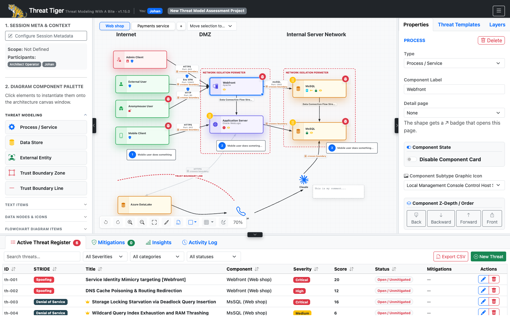
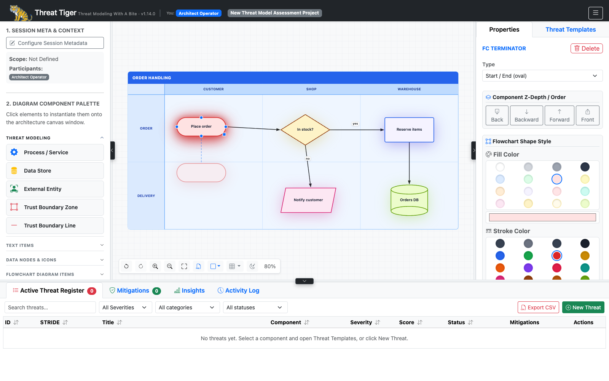
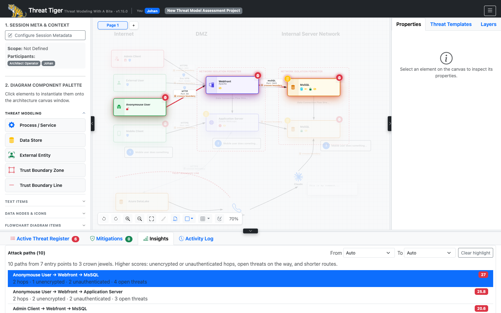
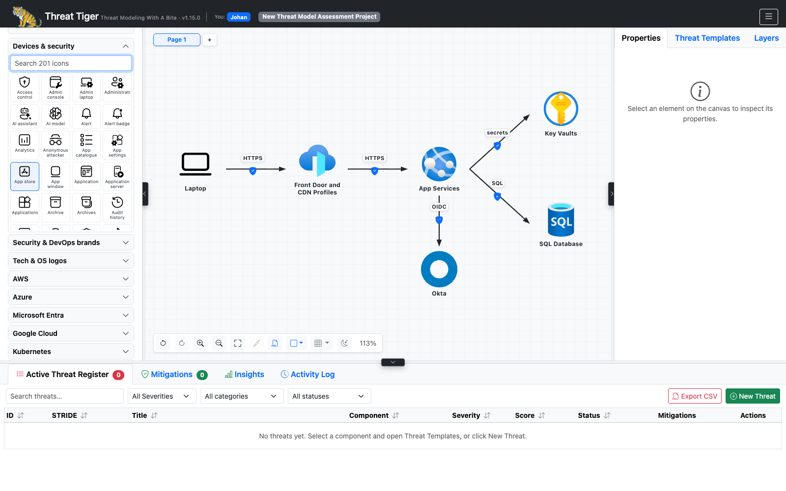
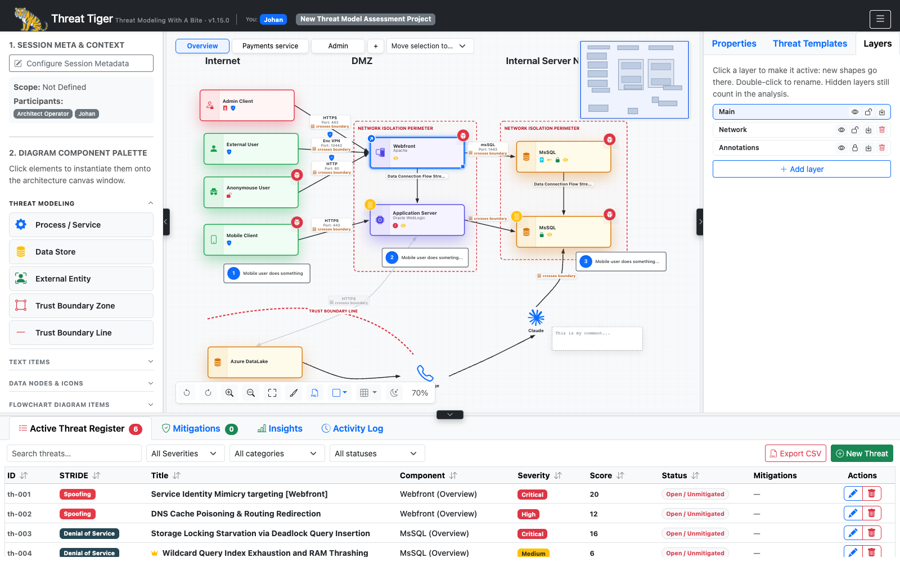

# Threat Tiger 🐯 — Threat Modeling With A Bite

**Threat Tiger** is an interactive, offline-first, client-side threat modeling web application designed to help developers, software architects, and security engineers design, analyze, and secure their system architectures.

Threat Tiger is a single HTML file plus a few local assets. It needs no installation, no database and no internet connection, and it never sends your data anywhere: your architecture and threat assessments stay in your browser and in the files you export.

**Current version: 1.16.0** (also shown in the app under Help & License). See [What's new](#whats-new-) and the [changelog](CHANGELOG.md).

A demo site is available here: [https://jozeta.github.io/threat-tiger/threat-tiger.html](https://jozeta.github.io/threat-tiger/threat-tiger.html)



---

## 🚀 Key Features

*   **Interactive architecture canvas**: drag and drop processes, data stores, external entities, trust zones and trust boundary lines, infrastructure nodes, steps, text, flowchart shapes, swimlanes and your own images, align or space out a selection evenly, organise shapes on layers you can hide or lock, split big models over pages with drill-down links, copy a shape's look with a format painter, see line jumps where flows cross, find your way around big diagrams with a minimap, and use about 2,000 icons: devices and security symbols, security and DevOps brands, tech and OS logos, and official AWS, Azure, Microsoft Entra, Google Cloud and Kubernetes icons (see [their terms](vendor/stencils/README.md)). More than 200 icons (servers, code, web, infrastructure, databases, security, people). Change any node's type from **Properties** (for example process → data store, or rectangle → decision) without losing its name, flows or threats.
*   **Flowcharts and swimlanes**: hover a connection point of a flowchart shape to preview the next step, click to add it (same shape and colours, already connected). Drop nodes into swimlane cells (the target cell is highlighted and grows to fit, with padding), drag column and row borders to resize them, and pick a colour theme per swimlane.
*   **Trust-boundary analysis**: data flows that cross a trust zone or boundary line are detected live and marked on the canvas.
*   **Threat suggestions**: a curated library of 601 concrete threats (OWASP, CWE, MITRE ATT&CK references; real-world incidents as examples; typical controls). Suggestions are ranked: **triggered by your model** (security switches, boundary crossings, connected flows — with the reason), **relevant for this component** (recognised from its icon and name, e.g. API, S3 bucket, administrator), then the rest. Every suggestion can be added (it then leaves the list), ignored, or marked **not applicable** with a reason, which is kept in the model and the report. The **Component Label** field suggests names that fit the component type. See [docs/threat-templates.md](docs/threat-templates.md).
*   **Threat register**: likelihood × impact scoring, status and mitigation tracking, search and filters (severity, STRIDE category, status, "needs review"). Click a threat to jump to its component.
*   **Insights**: summary tiles, open-risk heat map, STRIDE coverage per component, boundary crossings, model checks (unconnected components, duplicate names, …) and ranked attack paths from entry points to crown jewels, highlighted on the canvas and listed in the Markdown report.
*   **Reviews and diagram clarity**: a review mode that freezes the layout while threats and properties stay editable, a title block (diagram level, version, status, author, date) and an automatic legend for the canvas, PNG and print, and elbow (right-angle) connectors.
*   **Undo / redo**, automatic **History** snapshots, and an activity log.
*   **Import / export**: JSON (full, or a git-friendly variant that diffs cleanly), Mermaid flowcharts (import: nodes become flowchart shapes, subgraphs trust zones, laid out automatically), CSV, Markdown report (with an embedded Mermaid diagram), Mermaid diagram, PNG and a print-ready report.
*   **Keyboard and screen-reader friendly**, works on narrow screens, light and dark canvas themes, isometric views.

### Screenshots

<table>
  <tr>
    <td width="50%"><br><sub><b>Flowcharts and swimlanes:</b> hover a connection point to preview the next step; the Type dropdown switches shapes.</sub></td>
    <td width="50%"><br><sub><b>Attack paths:</b> routes from entry points to a crown jewel, ranked by risk, with the top path highlighted on the canvas.</sub></td>
  </tr>
  <tr>
    <td width="50%"><br><sub><b>Icon sets:</b> a small Azure architecture (laptop, Front Door, App Services, Key Vault, SQL Database, Okta), with the icon sets in the palette.</sub></td>
    <td width="50%"><br><sub><b>Pages and layers:</b> page tabs at the top left, a drill-down badge on Webfront, the minimap, and the Layers tab with a hidden or locked layer.</sub></td>
  </tr>
</table>

---

## What's new 🆕

**1.16.0** adds three diagram features:

- **Review mode** freezes the layout while names, properties, threats and mitigations stay editable, so nothing gets moved by accident during a review. It is saved with the model; the **Review mode** badge in the header turns it off.
- **Title block and legend:** the model name, diagram level, version, status, author and date, plus a legend of what the diagram uses, in the canvas corner, the PNG export and the print.
- **Elbow connectors:** data flows with right angles only, through your bend points.

**1.15.2** fixes a double-click in the palette adding two shapes stacked on top of each other.

**1.15.1** was a bug-fix release. Its main fixes:

- **Icons** from the icon sets drag like any other shape (press, move, release), and can be dragged from the palette onto the canvas.
- **Zoom** buttons and the mouse wheel zoom around the centre of the view.
- **Privacy:** an imported image path such as `//host/image.png` is removed instead of loading from another website without asking.
- **Threat templates backup** keeps every field and the built-ins you deleted, so a restore gives back the same library.
- **Copy and paste** keys work for text again outside the canvas.
- **Data flows, swimlanes, pages and flowchart shapes:** flow ends no longer attach to hidden shapes or loop back, lane drags leave locked shapes alone, imported pages without a position keep their trust zones apart, and flowchart shapes get all six STRIDE categories.
- Smaller fixes to PNG export, History, Clear all data, the threat pop-up and imports with odd values, plus the follow-up fixes to 1.15.0's pages, layers, align, format painter, attack paths, line jumps and minimap.

1.15.0 added attack paths, align and distribute, layers, icon sets, line jumps, pages, the minimap and the format painter. The full list for every version is in [CHANGELOG.md](CHANGELOG.md).

---

## 🛠️ How to Get Started

1.  Download or clone this repository.
2.  Open `threat-tiger.html` in a modern browser (Chrome, Edge, Firefox, Safari) — double-clicking the file works, everything is local.
    For the full experience (e.g. opening the demo model from the welcome screen) serve the folder over http, for example with `npm run serve` (see below) or `python3 -m http.server`.
3.  On first visit, choose **Open demo model** or **Start modeling**. Click **You:** in the header to set the name used in the activity log.
4.  Add components from the palette, connect them with data flows, and set their security properties in **Properties**.
5.  Open **Threat Templates** on a selected component to add threats — suggestions triggered by your model are listed first. Use the **Insights** tab to see what is still missing.

All other actions (import, export, reports, History, help) are in the **☰ menu** at the top right.

### Reviewing a model

- **Review mode:** **☰ → View → Review mode (freeze layout)**. Shapes can still be selected, so names, properties, threats and mitigations stay editable, but nothing can be moved, resized, added, deleted, pasted or aligned, and flows can't be bent or reconnected. The setting is saved with the model (default: off). Click the **Review mode** badge in the header to turn it off.
- **Title block and legend:** fill in the diagram details (level, version, status, author, date; all optional) under **Configure Session Metadata**, then **☰ → View → Show title block and legend** (default: off; remembered in this browser). The block sits in the bottom-right corner of the canvas and is added below the diagram in **Save as PNG** and in the print.
- **Elbow connectors:** select a data flow and choose **Elbow (right angles)** under **Curve Rendering Style** in Properties. New flows stay smooth (sharp in isometric views).

### Keyboard

| Key | Action |
|---|---|
| Tab / Shift+Tab | Move between components and data flows on the canvas |
| Enter / Space | Select the focused item |
| Arrow keys (Shift for larger steps) | Move the selection |
| Delete / Backspace | Delete the selection (asks first if threats would be deleted) |
| Escape | Deselect |
| Ctrl/Cmd+Z, Ctrl/Cmd+Shift+Z or Ctrl+Y | Undo / redo |
| Ctrl/Cmd+C, Ctrl/Cmd+V | Copy / paste components (with the data flows between them) |

---

## 🔒 Your data

*   Everything is stored **only in your browser** (localStorage for the current model, IndexedDB for History snapshots). Nothing is uploaded.
*   Anyone with access to your browser profile can read it. Use **☰ → Clear all data in this browser…** on shared machines, and keep exported files somewhere appropriate — threat models describe weaknesses of real systems.
*   If you host Threat Tiger yourself, give it its **own origin** (domain or sub-domain). Browser storage is shared by every page on the same origin.
*   When an imported model loads images from other websites, Threat Tiger asks first, because loading them tells those websites that the model was opened.
*   The activity log is a convenience history, not a tamper-proof audit trail.

---

## 🐳 Docker

The image is built from the files in this folder and served by unprivileged nginx with security headers.

```sh
docker build -t threat-tiger .
docker run -d --name threat-tiger -p 8080:8080 threat-tiger
```

Then open <http://localhost:8080/>.

---

## 💻 Development

The app is `threat-tiger.html` (HTML, CSS and vanilla JavaScript in one file). Front-end libraries — Bootstrap 5.3.2, Bootstrap Icons 1.13.2 and Font Awesome 6.5.1 — are bundled in `vendor/` (see `vendor/README.md`). `threat_templates.json` holds the threat library, including the conditions that trigger suggestions — its format and curation are described in [docs/threat-templates.md](docs/threat-templates.md).

Development tooling is optional and only needs Node.js:

```sh
npm install        # installs Playwright (dev only)
npm test           # end-to-end tests in your installed Microsoft Edge
npm run serve      # http://127.0.0.1:4173/threat-tiger.html
npm run sync       # run after editing the script or threat_templates.json
```

`npm run sync` updates the parts of `threat-tiger.html` that are generated: the Content-Security-Policy hash of the inline script and the embedded copy of the templates. It also verifies the vendored files against `vendor/checksums.json`. The tests fail if you forget to run it.

To run the tests in Chrome instead of Edge: `PW_CHANNEL=chrome npm test`. To test a running deployment, e.g. the Docker container: `PW_BASE_URL=http://127.0.0.1:8080 npm test`.

The version is `APP_VERSION` in `threat-tiger.html` (shown in Help & License and stored in exported files). Changes are listed in [CHANGELOG.md](CHANGELOG.md).

---

## 🤝 Feedback & Support

For bug reports, feature requests, or general feedback, you can:
*   Visit the project's GitHub page: [https://github.com/jozeta/threat-tiger](https://github.com/jozeta/threat-tiger)
*   Contact the developer via email: [johan.zetterstrom@protonmail.com](mailto:johan.zetterstrom@protonmail.com)

---

## 📄 License

This project is licensed under the MIT License. See [LICENSE](LICENSE) for details. Bundled third-party assets keep their own licenses (see `vendor/README.md`).
